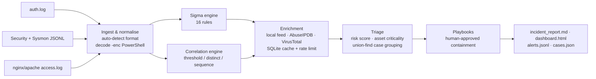

# Sigilant: Detection-as-Code SOC Pipeline

Sigilant is a Python SOC pipeline built from scratch. It takes raw Linux, Windows (Security + Sysmon) and web server logs and runs them through the same workflow an L1/L2 SOC team uses:

```
 ingest ─▶ normalise (ECS) ─▶ detect (Sigma + correlation) ─▶ enrich (threat intel)
        ─▶ triage (risk score, case correlation) ─▶ respond (playbooks) ─▶ report (MD / HTML / JSON)
```

On the bundled lab scenario it turns **846 raw events** into **22 alerts** across **22 MITRE ATT&CK techniques**. Those alerts are correlated into **2 prioritised P1 incidents**, each with containment actions that wait for analyst approval. The benign noise in the dataset (updater tasks, Defender scanning LSASS, password typos) raises no false positives.



## Features

| Stage | What it does | SOC concept shown |
|---|---|---|
| **Ingest** | Auto-detects and parses `auth.log` (BSD + RFC3339), Windows Security/Sysmon JSON, Apache/Nginx combined logs. Normalises to ECS-style fields. Double-URL-decodes web requests and **decodes base64 `-EncodedCommand` PowerShell**. | Log sources, normalisation, obfuscation (T1027/T1140) |
| **Detect: Sigma** | A Sigma engine written from scratch. It supports modifiers (`contains`, `startswith`, `endswith`, `re`, `cidr`, `all`, `windash`), wildcards, keyword search and a recursive-descent condition parser (`and/or/not`, parentheses, `1 of sel_*`, `all of them`). | Detection engineering, Sigma |
| **Detect: correlation** | Stateful sliding-window rules: **threshold** (brute force), **distinct count** (password spraying, dir enumeration) and **sequence** (success after failures). | SIEM correlation rules |
| **Rule → SIEM query** | Converts every Sigma rule into **Splunk SPL** and **Microsoft Sentinel KQL**. | Query languages |
| **Enrich** | Extracts IPs, domains and hashes, including IOCs hidden inside decoded PowerShell. Looks them up in an offline feed plus AbuseIPDB and VirusTotal, with a SQLite TTL cache, per-provider rate limits and HTTP 429 back-off. | Threat intel, mini-SOAR |
| **Triage** | Risk score = severity + intel verdict + asset criticality + volume. Alerts are grouped into cases with **union-find over shared entities**, and the asset inventory maps internal IPs to hosts. Cases are ordered by kill-chain stage and assigned P1–P4 with an SLA. | Alert prioritisation, incident correlation |
| **Respond** | Playbooks (brute force, compromised account, web attack, malware, credential dumping, persistence, log tampering) generate `iptables` / `New-NetFirewallRule` / `net user` / `schtasks` commands. **Nothing is executed.** Every action is `pending_approval`, and protected accounts plus non-malicious hashes are never targeted. | SOAR, human-in-the-loop |
| **Report** | Markdown incident report (timeline, ATT&CK, IOCs, evidence, FP notes, verdict checkbox), self-contained HTML dashboard with an ATT&CK heatmap, and SIEM-ready JSON lines. | Incident reporting |
| **CI** | GitHub Actions lints the code, validates rules, runs a detection regression test (every rule must still fire), runs the pytest suite, and publishes the report and SPL/KQL as an artifact. | Detection-as-code |

## Detections

| Rule | Type | ATT&CK |
|---|---|---|
| Encoded PowerShell command line | Sigma | T1059.001, T1027 |
| Office app spawning shell / script host | Sigma | T1566.001, T1059 |
| Certutil file download (LOLBin) | Sigma | T1105 |
| PowerShell network connection to public IP (`cidr` filter) | Sigma | T1105 |
| Execution from user-writable folder | Sigma | T1204.002 |
| Domain reconnaissance (`whoami /all`, `net group`, `nltest`) | Sigma | T1087.002, T1033 |
| LSASS memory access (filtered for AV/EDR) | Sigma | T1003.001 |
| Scheduled task creation (filtered for updaters) | Sigma | T1053.005 |
| Local user created (4720) | Sigma | T1136.001 |
| User added to Administrators (4732) | Sigma | T1098 |
| Security log cleared (1102) | Sigma | T1070.001 |
| Sudo to interactive root shell | Sigma | T1548.003 |
| Linux account created / added to sudo | Sigma | T1136.001, T1098 |
| SQL injection in URL | Sigma | T1190 |
| Path traversal / LFI | Sigma | T1190 |
| Scanner user-agent (Nikto, sqlmap, …) | Sigma | T1595.002 |
| SSH brute force (8 fails / 2 min / account) | Threshold | T1110.001 |
| SSH password spraying (5 users / 10 min) | Distinct count | T1110.003 |
| SSH success after ≥5 failures | Sequence | T1078, T1110 |
| Windows logon spray against a host (4625) | Distinct count | T1110.003 |
| Windows logon success after failures | Sequence | T1078, T1110 |
| Web directory enumeration (20 distinct 404s / 2 min) | Distinct count | T1595.003 |

## Lab scenario (`sigilant simulate`)

The simulator writes a full day of realistic benign activity with three intrusions mixed in:

1. **01:20 Web attack on web01**: Nikto directory brute force, then sqlmap SQL injection, then path traversal to `/etc/passwd`.
2. **01:40 / 02:10 SSH on web01**: a brute force against `root`, then a password spray that guesses `deploy`. The attacker runs `sudo` to a root shell and creates the backdoor user `sysupdate` in the `sudo` group.
3. **09:31 Phishing on WS01 leading to lateral movement to DC01**: a macro document makes Word spawn encoded PowerShell, which downloads via certutil from a typosquatted domain. The payload runs from `C:\Users\Public`, performs recon and dumps LSASS, then password-sprays DC01 from WS01 and succeeds. It creates a rogue local admin, adds scheduled-task persistence and clears the Security log.

## Quick start

```powershell
python -m venv .venv
.\.venv\Scripts\activate            # Linux/macOS: source .venv/bin/activate
pip install -e ".[dev]"

sigilant simulate --out samples      # generate lab logs
sigilant run -i samples -o output    # full pipeline
start output\dashboard.html         # open the dashboard
```

Other commands:

```powershell
sigilant rules validate --strict     # lint rules (ATT&CK tags + documented false positives required)
sigilant rules test                  # regression: every rule must fire on the lab scenario
sigilant rules export --target kql   # Sigma -> Sentinel KQL  (or --target splunk)
sigilant enrich 185.220.101.47 update-cdn-microsoft.com   # ad-hoc IOC lookup
pytest -q                           # 41 unit + end-to-end tests
```

Docker:

```bash
docker build -t sigilant .
docker run --rm -v "$PWD/samples:/logs:ro" -v "$PWD/output:/output" sigilant
```

### Live threat intel (optional)

Set free-tier API keys as environment variables. Without them, or with `--offline`, only the local feed in `data/threat_intel.csv` is used.

```powershell
$env:ABUSEIPDB_API_KEY = "..."
$env:VT_API_KEY = "..."
```

### Run it on your own Windows machine

1. Install [Sysmon](https://learn.microsoft.com/sysinternals/downloads/sysmon) with the SwiftOnSecurity config. Optionally, enable command-line auditing for 4688.
2. Generate some activity, ideally with [Atomic Red Team](https://github.com/redcanaryco/atomic-red-team) in a VM you own.
3. Export the events and analyse them from an **elevated** PowerShell:

```powershell
.\scripts\export_windows_events.ps1 -Hours 24 -OutFile .\real_logs\windows_events.jsonl
sigilant run -i .\real_logs -o .\output_real
```

Linux `auth.log` and web access logs can be copied into the same folder. The file type is detected automatically.

## Project layout

```
sigilant/
  ingest/          linux_auth.py, windows.py, web.py, format auto-detection
  detection/       sigma.py (engine + SPL/KQL backends), correlation.py
  enrichment.py    providers, cache, rate limiter
  triage.py        scoring, asset inventory, union-find case builder
  playbooks.py     playbook matching, safe containment script generation
  report.py        Markdown, HTML (templates/dashboard.html.j2), JSON
  simulate.py      lab scenario generator
  pipeline.py      orchestration
  cli.py           command line
rules/sigma/       16 Sigma rules (windows / linux / web)
rules/correlation/ 6 correlation rules
config/            assets.yml (CMDB), playbooks.yml
data/              threat_intel.csv (offline feed)
scripts/           export_windows_events.ps1
tests/             pytest suite
```

## Extending

- **Add a detection**: drop a Sigma YAML into `rules/sigma/` and run `sigilant rules validate && sigilant rules test`.
- **Tune a false positive**: add a `filter_*` selection and `and not filter_*` to the condition. See the LSASS and schtasks rules.
- **New log source**: add a parser module with `parse_file()` and `sniff()`, then register it in `sigilant/ingest/__init__.py`.
- **Ideas**: a Wazuh `alerts.json` ingester, GeoIP "impossible travel", Elastic/OpenSearch output, an LLM-written analyst note that is clearly labelled as AI-generated and always shows the raw evidence.
